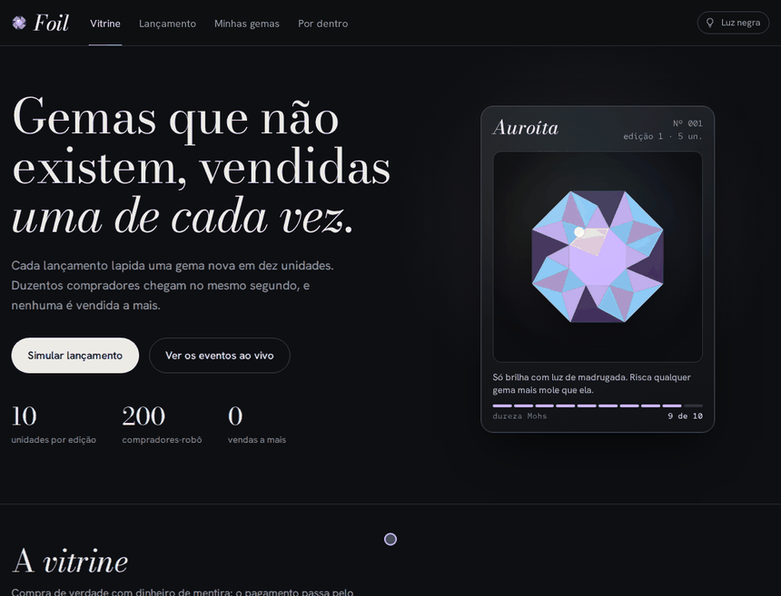
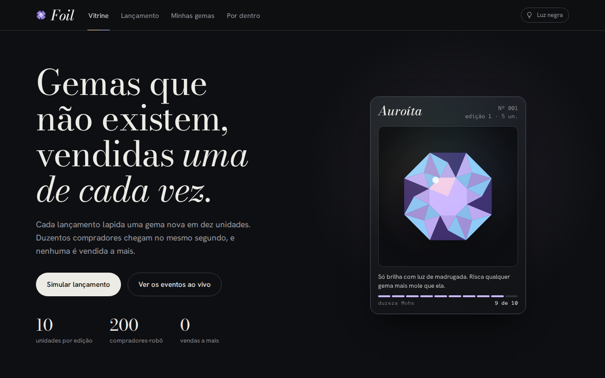
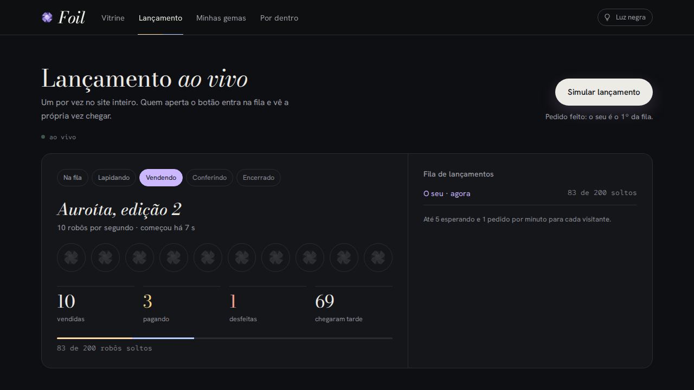
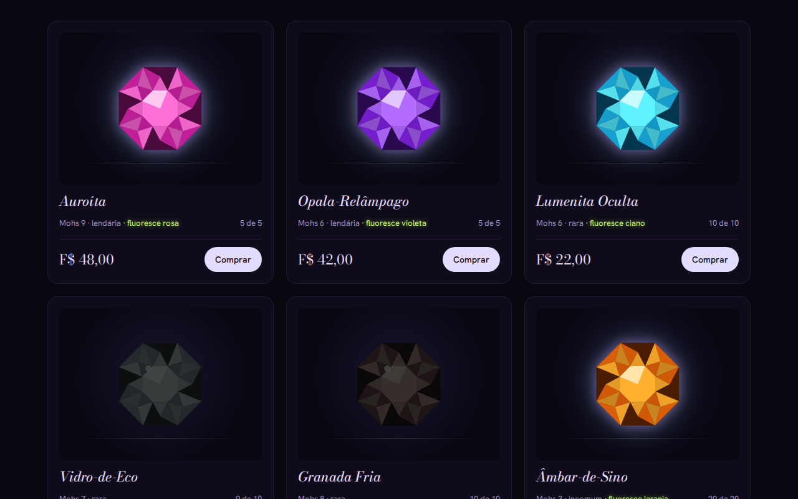
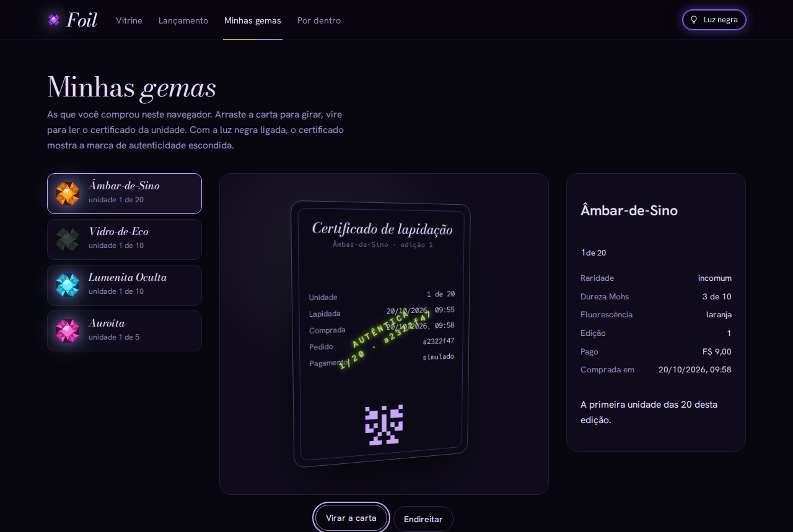
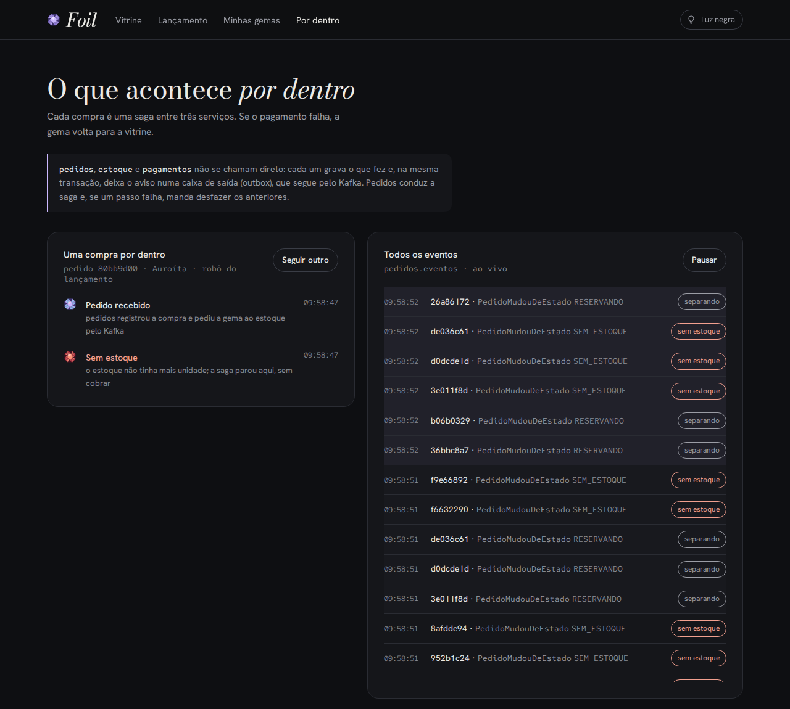
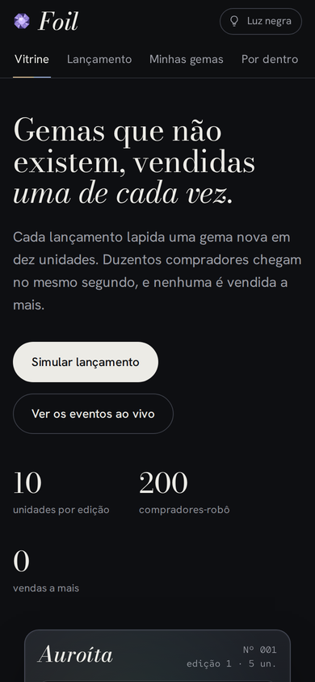

# Foil

Loja de gemas que não existem, feita como **vitrine de arquitetura de eventos**: três serviços que conversam por
Kafka (Redpanda), uma saga que desfaz os passos quando algo falha e um lançamento de gema rara em que 200
compradores disputam 10 unidades **sem nunca vender a mais**. O pagamento passa pelo
[Fiel](https://github.com/Lakes777/fiel), com dinheiro de mentira.



> Em construção, uma fase por vez. A especificação completa (decisões, fases e critérios de aceite) está em
> [docs/SPEC.md](docs/SPEC.md).

## Andamento

| Fase | Entrega | Situação |
|---|---|---|
| 1. Esqueleto | Maven multi-módulo, 3 serviços com `/saude`, Flyway, contratos, Testcontainers, CI | feita |
| 2. Estoque | Cartas, edições, reserva atômica, devolução | feita |
| 3. Eventos | Outbox, envelope, consumidores idempotentes, partição por pedido | feita |
| 4. Saga | Máquina de estados, compensações, prazo de 5 min, fila de mortos | feita |
| 5. Pagamento | Compra pelo Fiel de verdade: cobrança, QR, aviso assinado, estorno | feita |
| 6. Lançamento | 200 robôs contra 10 unidades, fila, limite por IP, ao vivo por SSE | feita |
| 7. Interface | Vitrine, lançamento ao vivo, minhas gemas com inspetor 3D, eventos por dentro, luz negra | feita |
| 8. Publicação | No ar em [foil.andrelagos.dev](https://foil.andrelagos.dev), limpeza das 4h10, um processador | feita |
| 9. Observabilidade | OpenTelemetry, Prometheus, Grafana, Jaeger | |

## Módulos

| Módulo | O que tem |
|---|---|
| `contratos` | Envelope dos eventos (`id`, `tipo`, `versao`, `ocorridoEm`, `pedidoId`, `dados`), tópicos e os comandos/eventos de cada serviço |
| `comum` | Base dos três serviços: `GET /saude` (200 só com banco e Redpanda respondendo; 503 dizendo qual caiu), outbox, consumidor idempotente, tópicos e, nos testes, os contêineres |
| `pedidos` | Orquestrador da saga e dos lançamentos: `POST /pedidos`, `GET /pedidos/{id}`, `GET /minhas`, `POST /lancamentos`, `GET /lancamentos`, `GET /eventos` (SSE) (porta 8091) |
| `estoque` | Gemas, edições, reserva e devolução; `GET /vitrine`, `/cartas`, `/cartas/{id}/edicoes`, `/edicoes/{id}` (porta 8092) |
| `pagamentos` | Cobranças simuladas (os robôs) e no Fiel (a compra manual), cancelamento e estorno; `POST /fiel/avisos` (porta 8093) |
| `ponta-a-ponta` | Testes com os três serviços (e o Fiel) como processos de verdade, derrubando um deles |
| `web` | A interface: React + TypeScript + Vite, ao vivo por SSE, testes com Vitest |

Cada serviço tem o próprio banco (`foil_pedidos`, `foil_estoque`, `foil_pagamentos`) e as próprias migrações Flyway.

## Como o estoque não vende a mais

A reserva é uma linha de SQL só, e quem decide se ainda tem carta é o banco:

```sql
update edicao set disponivel = disponivel - 1 where id = :edicao and disponivel > 0
-- zero linhas alteradas = acabou
```

Mais duas travas: um `check (disponivel >= 0 and disponivel <= total)` na tabela e a chave primária da reserva no
id do pedido, que impede o mesmo pedido de levar duas unidades. A reserva guarda o resultado (`reservada`,
`sem_estoque`, `devolvida`), então o mesmo pedido repetido recebe sempre a mesma resposta: quem ficou sem estoque
não leva depois uma unidade devolvida por outro. A devolução só acontece para quem consegue trocar `reservada` por
`devolvida`, então devolver duas vezes devolve uma unidade só.

O teste solta **200 pedidos ao mesmo tempo numa edição de 10** e exige exatamente 10 reservas, 190 "sem estoque",
nenhum erro e `disponivel = 0`. As contraprovas (o código trocado de propósito, e o teste tem de quebrar):

| Versão trocada | Resultado |
|---|---|
| Sem o `and disponivel > 0` | 190 pedidos estouram o `check` do banco: erro em vez de "sem estoque" |
| Apagar a reserva quando fica sem estoque (em vez de guardar o resultado) | O pedido repetido leva uma unidade devolvida depois, e a saga dele já tinha acabado |
| Jeito ingênuo: lê o disponível em Java e grava `disponivel = lido - 1` | **20 e 15 vendas** em duas rodadas, numa edição de 10, e o `check` não pega, porque o número nunca fica negativo |

## Como nenhum evento se perde nem é aplicado duas vezes

- **Outbox:** o serviço nunca publica no Redpanda dentro da regra de negócio. Ele grava o evento na tabela `saida`,
  na **mesma transação** da mudança de estado (gravar fora de uma transação é proibido e dá erro). Um publicador lê
  os pendentes em ordem e só marca como publicado depois da confirmação do Redpanda; no primeiro erro, para, para
  não passar um evento na frente do outro.
- **Consumidor idempotente:** quem consome anota o id do evento na tabela `evento_processado`, na mesma transação do
  efeito e da resposta. O mesmo id de novo não faz nada.
- **Ordem:** a chave de cada mensagem é o id do pedido, então tudo de um pedido cai na mesma partição (3 por tópico).

| Queda | O que acontece | Teste |
|---|---|---|
| Entre gravar e publicar | O evento fica pendente no banco e sai quando o serviço volta | `quedaEntreGravarEPublicarNaoPerdeOEvento` |
| Entre publicar e marcar | O evento sai duas vezes com o mesmo id; o consumidor ignora a segunda | `quedaEntrePublicarEMarcarRepublicaOMesmoId` + `oMesmoComandoEntregueDuasVezesTemEfeitoUmaVez` |
| Redpanda fora | Nada é marcado como publicado; o publicador desiste em segundos, sem travar | `redpandaForaDeixaOEventoPendente` |
| Banco do consumidor fora | A mensagem é tentada de novo para sempre, com espera crescente (até 30 s); a partição espera, nada se perde | `erroPassageiroEReaplicadoAteDarCertoENadaSePerde` (15 falhas seguidas) |
| Evento que nunca sai (grande demais) | Só os eventos seguintes do mesmo pedido esperam; os outros pedidos seguem | `eventoQueNaoSaiTravaSoOMesmoPedido` |

Mensagem com contrato quebrado (tipo ou versão desconhecidos, JSON inválido) não adianta tentar de novo: vai para a
fila de mortos, sem travar as seguintes.

Contraprovas: com o tratamento de erro padrão do Spring Kafka (10 tentativas sem espera), a mensagem passageira é
descartada e o teste quebra; sem a checagem do id repetido, o mesmo comando entregue duas vezes gera duas respostas
`UnidadeReservada`; sem a transação no consumidor, a gravação na saída é recusada; marcando como publicado mesmo
quando o envio falha, o evento se perde (o teste do Redpanda fora quebra).

Mensagem com contrato quebrado vai para a **fila de mortos** (`<tópico>.mortos`): cada serviço guarda as suas e
expõe `GET /mortos` e `POST /mortos/{id}/reprocessar`, que devolve a mensagem ao tópico de origem.

## A saga

O serviço de pedidos orquestra; estoque e pagamentos só respondem.

```
RESERVANDO ──UnidadeReservada──> AGUARDANDO_PAGAMENTO ──PagamentoAprovado──> CONFIRMADO
    │  └──ReservaRecusada──> SEM_ESTOQUE           │  └──PagamentoRecusado──────────────┐
    └──prazo (2 min)──┐                             └──prazo (5 min) + CancelarCobranca──┤
                      └──────────> LIBERANDO (DevolverUnidade) ──UnidadeDevolvida──> CANCELADO
                                    └──prazo (1 min): reenvia a devolução
```

- Cada passo trava o pedido, confere o estado e grava o estado novo e os próximos comandos numa transação só.
- Evento que chega tarde (depois do prazo) é ignorado: a compensação já está a caminho.
- Pagamento aprovado depois do prazo é **estornado**: o `CancelarCobranca` vai na mesma partição, depois do
  `CobrarPedido`; se a cobrança ainda nem existia, ela fica proibida.
- Devolução que chega antes da reserva (a reserva estava na fila de mortos e foi reprocessada depois) fica gravada
  como trava: a reserva atrasada é recusada em vez de prender uma unidade para sempre.

**O teste que importa** (`ponta-a-ponta/DerrubarPagamentosTest`): sobe pedidos, estoque e pagamentos como três
processos Java, com Postgres e Redpanda de verdade, e derruba pagamentos com `kill -9`.

| Cenário | Resultado exigido |
|---|---|
| 20 compras numa edição de 10 com pagamentos fora; pagamentos volta antes do prazo | Nenhum pedido preso; 10 sem estoque; cada `CONFIRMADO` tem uma cobrança aprovada e uma unidade a menos |
| 5 compras com pagamentos fora até o prazo vencer; depois ele volta | Os 5 cancelados, estoque cheio de novo, e **nenhuma cobrança aprovada**: as atrasadas foram estornadas ou proibidas |
| 60 compras; pagamentos cai com `kill -9` **no meio** (na rodada medida, 59 cobranças ainda pendentes) | Nenhum pedido preso; cobranças aprovadas = confirmados; estoque = 60 − confirmados |

O teste também achou um problema de operação: depois do `kill -9`, o pagamentos novo ficava **37 s** parado,
esperando a sessão do consumidor morto vencer (padrão de 45 s). Com sessão de 10 s, volta em ~9 s.

Contraprovas: aceitando "pagamento aprovado" em qualquer estado, um pedido cancelado volta a ser confirmado (dois
testes da saga quebram); sem o `CancelarCobranca` no prazo, as cobranças atrasadas ficam aprovadas para sempre (o
cenário 2 não termina); sem a trava da devolução, a reserva reprocessada prende a unidade.

## Pagamento pelo Fiel

A compra manual é cobrada no [Fiel](https://github.com/Lakes777/fiel), a carteira digital de mentira que fiz
antes. Os robôs do lançamento (fase 6) continuam no pagamento simulado.

```
pedidos ──CobrarPedido{forma: FIEL}──> pagamentos ──POST /cobrancas (referência = id do pedido)──> Fiel
pedidos <──CobrancaCriada{qr, link}──  pagamentos                                                   │
                                                          o visitante paga o QR em fiel/pagar ──────┤
pedidos <──PagamentoAprovado─────────  pagamentos <──aviso cobranca.paga (HMAC + carimbo de tempo)──┘
```

- **Quem fala com o Fiel não é o consumidor do Redpanda.** O consumidor só anota a cobrança (`pendente`,
  `cancelando`, `estornando`); um trabalhador faz o pedido HTTP sem transação aberta e aplica a resposta
  conferindo a situação de novo. Com o Fiel fora do ar, só as compras manuais esperam (com espera crescente); os
  comandos dos robôs seguem.
- **Nada duplica ao repetir:** a cobrança leva a referência (o id do pedido), que o Fiel trata como idempotente; o
  estorno leva o id do pedido como `Idempotency-Key`; o aviso repetido cai no `evento_processado`.
- **Aviso conferido:** HMAC-SHA256 sobre os bytes recebidos, comparado em tempo constante, e o carimbo de tempo a
  no máximo 5 min (um aviso capturado e reenviado depois é recusado). Se o aviso se perder, a cobrança pendente é
  conferida no Fiel a cada 15 s.
- **Pagou depois que a saga desistiu:** o estorno é automático. Cancelar no Fiel e receber "já está paga", ou receber
  o aviso de paga com a cobrança sendo cancelada, viram estorno; o dinheiro volta para o visitante.
- **O Fiel recriado às 4h:** o Foil recadastra o endereço dos avisos na partida e às 4h05, guardando o segredo novo.
- `CobrarPedido` ganhou a `forma` numa **v2**; a v1 ainda é aceita (como simulada), para um comando antigo na saída
  não travar a partição depois da atualização.

**O teste que importa** (`ponta-a-ponta/CompraPeloFielTest`) sobe o **jar do Fiel de verdade** com os três
serviços. O visitante entra no Fiel pelo botão de visitante e paga o QR do pedido, como faria pelo navegador. O CI
monta o jar a partir do `main` do Fiel, então uma mudança lá que quebre o contrato aparece aqui.

| Cenário | Resultado exigido |
|---|---|
| Compra paga pelo QR | `CONFIRMADO`, o saldo do visitante cai o preço, a unidade sai do estoque |
| Pagamentos derrubado com `kill -9`; o visitante paga mesmo assim; o prazo vence; pagamentos volta | `CANCELADO` (prazo do pagamento), **o dinheiro volta para o visitante** (estorno no Fiel) e a unidade volta ao estoque |
| O Fiel recusa criar a cobrança (acima do limite dele) | `CANCELADO` (pagamento recusado), sem QR, unidade de volta |

Os casos difíceis também têm teste em pagamentos, contra um Fiel de mentira que obedece ao mesmo contrato: aviso
repetido três vezes aprova uma vez; assinatura errada, velha ou com o corpo mexido é 401; o Fiel que cria a cobrança
e perde a resposta duas vezes continua com **uma** cobrança; o aviso que chega com o cancelamento esperando o Fiel
voltar vira estorno; o segredo antigo para de valer no recadastro.

Contraprovas: tratando o aviso de "paga" com a cobrança cancelando como uma aprovação comum, o pedido que a saga já
desistiu recebe `PagamentoAprovado` e o dinheiro não volta (o teste do aviso depois do cancelamento quebra); sem
conferir o carimbo de tempo, um aviso de 10 minutos atrás é aceito. Sem conferir a referência antes de cancelar (o id do Fiel recomeça
do 1 quando ele é recriado às 4h), o cancelamento de um pedido antigo estorna o pagamento de um pedido novo que
ganhou o mesmo id. No Fiel, sem o índice único da referência, as
20 criações simultâneas viram **20 cobranças** para o mesmo pedido.

## O lançamento

O botão "Simular lançamento" abre uma edição nova de uma carta rara com **10 unidades** e solta **200 robôs**
comprando ao mesmo tempo. Cada robô é um pedido comum da saga, com o pagamento simulado recusando ~20%.

```
POST /lancamentos ─> NA_FILA ──vez dele──> ABRINDO ──EdicaoAberta──> SOLTANDO ──200 soltos──> ESPERANDO ──sagas no fim──> ENCERRADO
                                             │ AbrirEdicao (estoque)      10 robôs/s
                                             └──EdicaoRecusada──> FALHOU
```

- **Um lançamento por vez no site inteiro**, com fila visível (no máximo 5 esperando; o sexto recebe 503 com
  `Retry-After`). Quem garante é um índice único parcial no banco, não o código: dois lançamentos andando ao mesmo
  tempo viram erro do Postgres, não uma corrida.
- **Ritmo pelo relógio:** os robôs devidos são contados desde o começo (10 por segundo), não por rodada, e saem no
  máximo 50 de uma vez; uma pausa longa não vira rajada. Robôs e contador são gravados na mesma transação, então uma
  queda no meio continua de onde parou, sem robô a mais nem a menos.
- **Limite por IP:** 1 lançamento e 10 compras por minuto (IPv6 conta pelo /64), 429 com `Retry-After`. O IP do
  `X-Forwarded-For` só vale quando o pedido vem do proxy confiável; de fora, o cabeçalho é ignorado.
- **Ao vivo por SSE** (`GET /eventos`): lê o tópico `pedidos.eventos` sem grupo de consumidor, então cada instância vê
  tudo. Cada visitante tem uma fila própria: quem lê devagar é desconectado em vez de segurar os outros. Teto de 100
  conexões e 5 por IP.

**O teste que importa** (`ponta-a-ponta/LancamentoTest`) sobe os três serviços como processos e pede dois lançamentos
ao mesmo tempo. Resultado de uma rodada:

| Lançamento | Vendidos | Sem estoque | Desfeitos (pagamento recusado) | Presos |
|---|---|---|---|---|
| 1º | **10** | 189 | 1 | 0 |
| 2º (esperou na fila) | **10** | 186 | 4 | 0 |

As unidades dos pagamentos recusados voltam ao estoque a tempo dos robôs que chegam depois, por isso as 10 sempre
vendem. Os três bancos contam a mesma história: 10 pagamentos aprovados, 10 reservas e a edição zerada. O segundo
lançamento só começa depois que o primeiro termina, numa edição própria.

Dois detalhes que só os testes acharam: o Postgres guarda o horário em microssegundos e **arredonda** os
nanossegundos, então o começo gravado ficava até 1 µs depois do relógio e o primeiro segundo soltava 10 robôs em vez
de 11 (o horário agora é cortado antes de gravar). E o servidor só percebe que um visitante do SSE saiu na **segunda**
escrita depois do fechamento (a primeira cabe no buffer do sistema), por isso o "ainda aqui" a cada 15 s.

O "um por vez" também tem teste direto no banco: gravar um segundo lançamento andando, como faria um bug que pulasse a
fila, é recusado pelo índice.

Contraprovas: sem a trava da fila no `avancar()`, 8 rodadas ao mesmo tempo (como duas instâncias) chamam o próximo
juntas e uma delas leva erro do índice único. No painel, um visitante que conecta e **nunca lê** enche o TCP; se o
desconectar fosse feito na thread que lê o Kafka, ela ficaria esperando a escrita presa dele e o painel pararia para
todo mundo por mais de 60 s. Com o fechamento à parte, as 3000 mensagens chegam ao outro visitante e a chamada mais
lenta leva milissegundos. Um estoque que nunca responde recebe o `AbrirEdicao` 5 vezes e o lançamento termina em
`FALHOU` (`ESTOQUE_SEM_RESPOSTA`), sem parar a fila.

## A interface

Uma função por aba, cada uma com endereço próprio (`#vitrine`, `#lancamento`, `#colecao`, `#por-dentro`).

| | |
|---|---|
|  |  |
| **Vitrine:** nove gemas inventadas, cada uma com dureza na escala de Mohs de verdade. A gema é desenhada por código (corte brilhante visto de cima) a partir de uma chave de cor guardada no estoque, sem nenhuma imagem. | **Lançamento:** o estojo de 10 lugares apaga conforme as unidades saem, os números chegam pelo SSE, a fila mostra "o seu". |
|  |  |
| **Luz negra** (botão ou tecla L): as gemas com fluorescência acendem na cor delas e as outras apagam, como fluorita e calcita de verdade. | **Minhas gemas:** a carta em 3D (arrastar gira, V vira). O verso é o certificado da unidade, com uma marca em "tinta invisível" que só aparece na luz negra. |
|  |  |
| **Por dentro:** a saga de uma compra passo a passo e todos os eventos de `pedidos.eventos`, em lotes de 4 por segundo e com pausa. | No celular as abas deslizam e nada passa da largura da tela. |

- **Quem é quem sem conta:** a primeira compra cria um cookie `foil_visitante` (UUID aleatório, HttpOnly, SameSite=Lax);
  "Minhas gemas" lista só os pedidos desse cookie. Cookie adulterado vale como nenhum.
- **A unidade do certificado** ("4 de 10") é gravada na confirmação, com uma trava por edição e um índice único: 20
  confirmações ao mesmo tempo recebem de 1 a 20, sem repetir (contraprova: sem a trava, repete).
- **Compra uma vez só:** o pedido sai no clique, não num efeito do React. O StrictMode monta o diálogo duas vezes em
  dev, e com o pedido no efeito cada clique comprava duas gemas (o teste roda em StrictMode e exige um POST).
- **O catálogo** é uma migração repetível (`db/catalogo/R__catalogo.sql`): atualiza as gemas pelo nome e cria só a 1ª
  edição de quem ainda não tem. Os testes do estoque rodam sem ela, com as próprias cartas.
- A identidade ("joalheria à noite") saiu de um protótipo com 5 versões: [docs/prototipo-fase-7.html](docs/prototipo-fase-7.html).

## No ar

Na mesma VM ARM da Oracle (1 núcleo) que o Fiel e os outros projetos, atrás do Caddy dela (`deploy/`).

- **Imagens montadas no PC** para ARM (`deploy/publicar.sh`), uma por serviço a partir do `*-exec.jar`, mais as telas
  num Caddy mínimo. Cada serviço com 448 MB e heap de 256 MB; o Redpanda com 384 MB e um núcleo.
- **Duas redes:** o Redpanda (sem senha) fica numa rede só do Foil; os serviços entram também na rede do Caddy e do
  Postgres com apelidos `foil-*`. Três bancos no Postgres compartilhado, cada um com usuário próprio, dono só do seu.
- **O Caddy só deixa passar o que a interface usa** (lista fechada): a fila de mortos, o botão de reprocessar e o
  `/saude` não saem da VM, e caminho com `;`, `%` ou `..` é recusado antes da lista.
- **Compra pelo HTTP só pelo Fiel:** o pagamento simulado é dos robôs; aceitar `SIMULADA` no `POST /pedidos` público
  deixaria um curl levar gemas sem pagar.
- **Um processador muda as threads virtuais:** a primeira publicação travou o `/saude` (no Java 21, uma thread virtual
  esperando dentro de um `synchronized` prende o carregador, e com um núcleo só há um). Corrigido com trava no lugar do
  `synchronized`, pelo menos 4 carregadores por serviço, e o teste de ponta a ponta subindo as JVMs com um processador.
  Depois o projeto passou para o Java 25, em que o `synchronized` deixa de prender o carregador (JEP 491); as
  correções ficaram como segunda proteção.
- **Medido na VM:** um lançamento de 200 robôs vendeu exatamente 10 em 20 s, cada serviço ficou em ~190 MB, e os outros
  sites da VM seguiram respondendo em ~60 ms durante o lançamento.
- **Limpeza às 4h10:** saída publicada, ids de eventos e respostas a comandos repetidos saem em 4 dias; vendas,
  compras do visitante, edições dos lançamentos e mortos em 30. Os tópicos guardam no máximo 3 dias (retenção de 2 +
  segmento de 1: o Redpanda só apaga segmento fechado, e o padrão fecha em 14 dias), porque um id de evento apagado
  antes da mensagem sair do tópico deixaria um consumidor que relê aplicar o efeito duas vezes.

## Tecnologia

Java 25 (threads virtuais) · Spring Boot 4 · Spring Kafka · Redpanda · PostgreSQL 17 · Flyway · JUnit 5 ·
Testcontainers · React 19 · TypeScript · Vite · Vitest · GitHub Actions

## Rodar

Precisa de Java 25, Node e Docker.

```bash
dev/rodar-tudo.sh                  # tudo no PC: compose, o Fiel (repositório vizinho ../fiel), os 3 serviços e as telas
                                   # loja em http://localhost:5195, Fiel em http://localhost:5190
dev/rodar-tudo.sh parar

./mvnw verify                      # testes: sobe Postgres e Redpanda de verdade em contêineres (~5 min)
cd web && npm ci && npm test       # testes da interface (Vitest)

docker compose up -d               # Postgres (5434), Redpanda (19092) e o console do Redpanda (8090)
./mvnw install -DskipTests
./mvnw -pl estoque spring-boot:run -Dspring-boot.run.profiles=dev
curl localhost:8092/saude          # {"servico":"estoque","status":"ok","banco":"ok","kafka":"ok","migracao":"7"}
```
